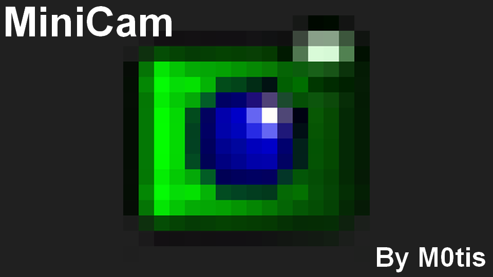
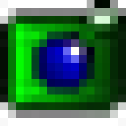

  
   
  <strong>La webcam à votre image.</strong>
    
  <em>Guide utilisateur · Windows</em>

---

> **MiniCam** transforme votre webcam en fenêtre vidéo personnalisable : réglez le cadrage, appliquez des effets et ajoutez vos propres éléments visuels.

| 🎥 CAMÉRA | 🪟 FENÊTRE | 🎨 IMAGE | ✨ FILTRES |
|:---:|:---:|:---:|:---:|
| Choisissez votre webcam | Adaptez l’affichage | Ajustez le rendu | Créez votre style |

## Sommaire

- [Démarrer](#-démarrer)
- [Ouvrir les paramètres](#-ouvrir-les-paramètres)
- [Personnaliser MiniCam](#-personnaliser-minicam)
  - [Caméra](#caméra)
  - [Fenêtre](#fenêtre)
  - [Image](#image)
  - [Tête](#tête)
  - [Filtres](#filtres)
- [Aperçu et commandes](#-aperçu-et-commandes)
- [Données et aide](#-données-et-aide)

## 🚀 Démarrer

1. Ouvrez le dossier **MiniCam**.
2. Double-cliquez sur **`MiniCam.exe`**.
3. Si nécessaire, ouvrez les paramètres pour choisir votre webcam.

> Gardez les fichiers et dossiers fournis avec MiniCam à côté de `MiniCam.exe` : ils sont nécessaires au fonctionnement de l’application.

## 🛠 Ouvrir les paramètres

Dans la fenêtre vidéo, utilisez l’une de ces commandes :

| Geste ou touche | Action |
|:---|:---|
| Double-clic sur la vidéo | Ouvrir les paramètres |
| **F10** ou **P** | Ouvrir les paramètres |
| **F11** | Activer ou quitter le plein écran vidéo |
| **Échap** | Fermer MiniCam |

Les paramètres sont organisés en cinq onglets : **Caméra**, **Fenêtre**, **Image**, **Tête**, **Filtres** et **Écran**.

## 🎨 Personnaliser MiniCam

### Caméra

- Sélectionnez le numéro de la webcam (**0 à 9**).
- Réglez la fluidité cible de **5 à 60 FPS**.
- Consultez la résolution détectée et ajustez la fenêtre vidéo à cette résolution.
- Utilisez **Redémarrer caméra** après un changement de périphérique ou si le flux doit être relancé.

La résolution et la fluidité obtenues dépendent de la webcam et de son pilote.

### Fenêtre

Choisissez la taille de l’image, puis adaptez la fenêtre à votre espace :

| Format | Dimensions |
|:---|:---:|
| Petit | 320 × 240 |
| Moyen | 480 × 360 |
| Grand | 640 × 480 |

Vous pouvez aussi :

- saisir une largeur et une hauteur personnalisées ;
- autoriser le redimensionnement et garder la fenêtre au-dessus des autres ;
- passer la vidéo en plein écran avec l’option **Plein écran** ou **F11** ;
- activer le **mode mini** sans barre de titre et déplacer la fenêtre avec la souris ;
- régler l’arrondi de chaque coin du mode mini, ou synchroniser les quatre coins ;
- choisir une petite fenêtre de paramètres.

### Image

Réglez le rendu de la webcam selon vos préférences :

- **Miroir** horizontal ;
- **Luminosité**, **contraste** et **saturation** ;
- **Zoom** manuel et cadrage horizontal / vertical ;
- couleur et transparence des bandes autour de l’image.

### Tête

Pour accéder aux options de suivi et de détourage, activez d’abord **Détecter les yeux et la bouche** dans **Filtres**.

- **Zoom automatique sur la tête** suit le visage et ajuste le cadrage avec des mouvements lissés.
- **Détourer la tête et remplacer le fond** isole la personne de l’arrière-plan.
- Choisissez une image de fond facultative ou retirez-la pour revenir au fond uni.

La qualité du suivi et du détourage varie selon l’éclairage, la visibilité du visage et la webcam.

### Filtres

#### Filtres de couleur

Activez le filtre couleur, sélectionnez un profil et réglez son intensité :

`Aucun` · `Noir et blanc` · `Sépia` · `Contraste fort` · `Niveau doux` · `Négatif` · `Chaud` · `Froid` · `Vintage`

#### Filtres visage

Activez **Détecter les yeux et la bouche**, puis ouvrez l’éditeur pour personnaliser le rendu :

- choisissez un style : **Rien**, **Repères**, **Lunettes**, **Moustache**, **Oreilles de chat** ou **Couronne** ;
- réglez la couleur et la taille ;
- importez une image et choisissez quelle zone conserver : **Aucune**, **Visage**, **Yeux**, **Bouche** ou **Yeux et bouche** ;
- ancrez l’image au sommet de la tête, au centre du visage, aux yeux ou à la bouche ;
- ajustez sa taille, ses décalages et son orientation par rapport à la tête ;
- ajoutez un texte, choisissez son ancrage, sa taille, sa position et son orientation ;
- réinitialisez indépendamment le positionnement de l’image ou du texte.

Le style **Rien** est transparent et n’ajoute aucune décoration.

#### Polices et images personnalisées

Le sélecteur de police propose un aperçu, des favoris et les **cinq dernières polices utilisées**. Il répertorie les polices Windows lisibles par MiniCam. L’importation de polices ouvre par défaut `C:\Windows\Fonts` ; les formats affichés comprennent TTF, OTF, TTC, OTC, FON, PFA, PFB, WOFF et WOFF2. La compatibilité dépend du fichier et du moteur de rendu.

Les images de filtre visage peuvent être importées en **PNG, JPG, JPEG, BMP, WEBP ou SVG**. MiniCam enregistre une copie préparée de l’image. Les fichiers d’image animée ne sont pas lus comme des animations.

## ⚡ Aperçu et commandes

| Commande | Fonction |
|:---|:---|
| **Modification en direct** | Actualise l’aperçu pendant les réglages compatibles |
| **Appliquer** | Applique les réglages |
| **Redémarrer caméra** | Applique les réglages et relance la webcam |
| **Redémarrer MiniCam** | Relance l’application |
| **Réinitialiser** | Restaure les réglages par défaut |
| **Enregistrer** | Active ou désactive la sauvegarde des réglages |
| **Mode sombre** | Bascule entre le thème sombre et le thème clair |
| **Fermer** | Ferme les paramètres sans quitter la vidéo |
| **Fermer MiniCam** | Quitte l’application |

## 📁 Données et aide

MiniCam conserve à côté de `MiniCam.exe` :

- `minicam_settings.json` — vos réglages enregistrés ;
- `filters\` — les images de filtre importées ;
- `filters\fonts\` — les polices importées ;
- `minicam.log` — un journal créé en cas d’erreur.

### La vidéo est noire ou la webcam ne démarre pas

1. Vérifiez que la webcam est branchée et n’est pas utilisée par une autre application.
2. Vérifiez dans Windows que MiniCam est autorisé à accéder à la caméra.
3. Essayez un autre numéro dans **Caméra**, puis cliquez sur **Redémarrer caméra**.
4. Si nécessaire, fermez puis relancez MiniCam.

### La vidéo est saccadée

- Réduisez la valeur de **Fluidité FPS**.
- Désactivez temporairement le détourage ou les filtres visage.
- Fermez les autres applications utilisant la webcam.

### Une image ou une police ne s’affiche pas

- Vérifiez que l’image est dans un format pris en charge et qu’elle peut être ouverte.
- Essayez une police TTF ou OTF courante ; tous les fichiers de police ne sont pas compatibles.
- Réimportez le fichier s’il a été déplacé ou supprimé.

Si le problème persiste, consultez `minicam.log` dans le dossier MiniCam.

## 📜 Licence

Les éléments originaux de MiniCam sont publiés sous licence **Creative Commons Attribution – Pas d’Utilisation Commerciale – Pas de Modification 4.0 International (CC BY-NC-ND 4.0)**.

**Attribution : MiniCam — Motis.**

Consultez le fichier [`LICENSE.txt`](LICENSE.txt) ou le [texte officiel de la licence](https://creativecommons.org/licenses/by-nc-nd/4.0/deed.fr).

Cette mention concerne les éléments originaux de MiniCam. Elle ne remplace pas et ne modifie pas les licences applicables aux bibliothèques, modèles et autres composants de tiers fournis avec l’application.

---

  
   
  MiniCam · votre image, votre fenêtre, votre style.

